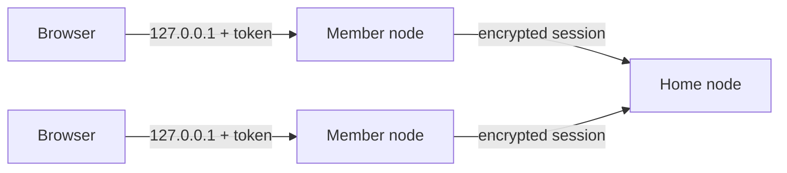
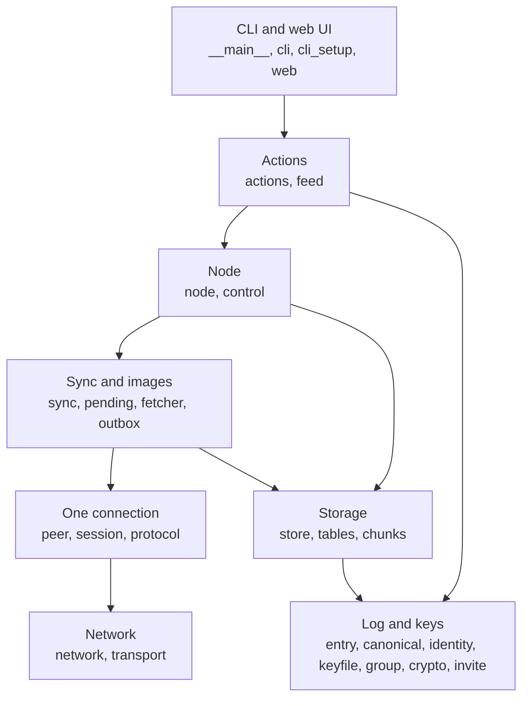
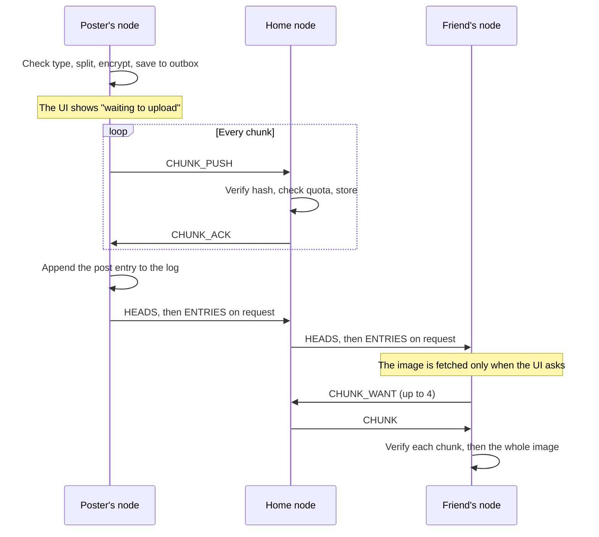
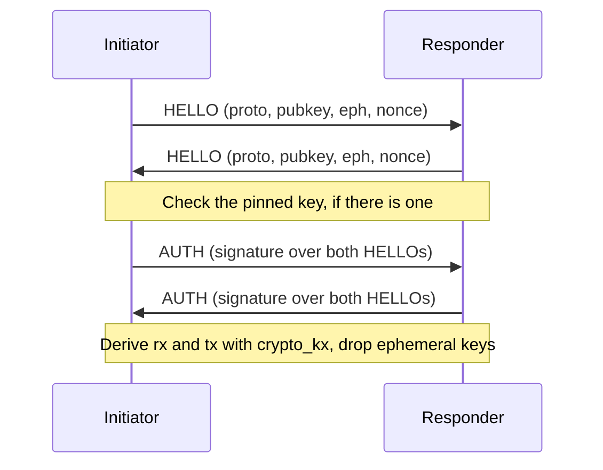

# Architecture

How Hearth fits together. [`spec.md`](spec.md) is the original build specification, and [`decisions.md`](decisions.md) records where the build resolved or departed from it. If they disagree with this page, the code and `decisions.md` win.

## The big picture

Hearth is a set of **per-member, append-only logs**. Every action a member takes (joining, setting a name, posting) is a signed entry in their own log. There's no shared database and no server-side logic: each node collects logs and merges them into a feed locally.

The network is **hub and spoke**. One node, the home node, runs nonstop. It's the group's admin, accepts invites, and holds every log and every image. Members dial it and never connect to each other. Members don't listen on the network at all.

Both sides run identical code. A home node only turns off the web UI, acts as admin, and keeps a copy of every chunk.



## Layers

Each layer only calls the one below it. The store, log, crypto and identity modules are used across them.



| Module | Job |
| --- | --- |
| `__main__.py` | Parses arguments and turns errors into one friendly line |
| `cli.py`, `cli_setup.py` | The commands: one-shot ones, and those that set up a data directory |
| `web.py`, `static/` | The local web UI: one page and a small JSON API |
| `actions.py` | What a user can ask for, shared by the CLI, the control channel and the web UI |
| `feed.py` | Turns stored entries into posts a person can read |
| `node.py` | Owns the identity, store, keys and every connection |
| `control.py` | Lets a one-shot command talk to a running node |
| `sync.py` | Moves logs with `HEADS`, `WANT` and `ENTRIES` |
| `pending.py` | Holds genuine entries whose author isn't a member yet |
| `fetcher.py` | Fetches image chunks on demand, sharing concurrent requests |
| `outbox.py` | Holds image posts until the home node has every chunk |
| `peer.py` | One connection's state machine |
| `session.py` | What the handshake signs, session keys, and frame encryption |
| `protocol.py` | Framing and strict message schemas |
| `network.py` | Address parsing, dial targets and backoff |
| `transport.py` | The outer layer of a connection: TLS when dialling, PROXY v2 when accepting |
| `store.py`, `tables.py` | SQLite: the schema and every query |
| `chunks.py` | Image type checks, splitting, reassembly and chunk files |
| `entry.py` | The entry format, signing and pure validation |
| `canonical.py` | Strict JSON parsing and deterministic JSON bytes |
| `identity.py`, `keyfile.py`, `group.py` | Key pairs, passphrase-encrypted files and the group key |
| `crypto.py` | Encrypting content with the group key |
| `invite.py` | Creating, redeeming and checking invite links |
| `audit.py`, `backup.py` | `debug log` and `debug verify`; online backups |
| `settings.py`, `config.py`, `lockfile.py` | `config.json`, compiled-in limits, and one process per directory |

## Identity and keys

On first run a node generates two independent key pairs, as libsodium advises:

- an **Ed25519** signing key, whose hex public key is the member's account ID;
- an **X25519** key, used only to receive the sealed group key when joining.

`identity.key` and `group.key` share one format: a type tag, a 16-byte salt, the Argon2id limits, and a SecretBox ciphertext. The tag stops the files being swapped, and loading accepts only libsodium's `INTERACTIVE` and `MODERATE` limits, rejecting anything else before the expensive derivation. Files are written atomically with mode `0600`.

## Log entries

| Field | Meaning |
| --- | --- |
| `v` | Format version, always 1 |
| `group` | Group ID |
| `author` | Author's public key |
| `seq` | 1, 2, 3… with no gaps |
| `prev` | Hash of the author's previous entry; null at `seq` 1 |
| `ts` | Author's clock, for display only and never trusted |
| `kind` | `group_create`, `member_add`, `profile` or `post` |
| `body` | Kind-specific content |
| `sig` | Ed25519 signature |

- **Signed bytes:** `hearth/entry/v1\n` plus canonical JSON of every field except `sig`.
- **Entry hash:** BLAKE2b-256 of the same bytes. `prev` links to it, forming a chain per author.
- **Validation** is a pure function, `validate_entry`, with no database access. The store looks up the author's head and the member set, calls it, then writes.
- **Membership** is the admin's chain of `member_add` entries.
- **Ordering:** each node sets `sort_ts = min(ts, received_at)` once, when it first stores an entry. A future-dated post shows when it arrived, and a member can still backdate (an accepted limit).
- **Forks:** one identity must write from only one data directory. A second, different entry for an `author` and `seq` we already hold is a fork: it's rejected, the author is marked as forked, and `status` and the UI warn about it. Hearth detects forks but doesn't repair them.

## Encryption

| What | How |
| --- | --- |
| Post and profile content | SecretBox with the 32-byte group key and a random nonce |
| Image pieces | Split into 1 MiB pieces, each encrypted with the group key |
| Group key in transit | SealedBox to the joiner's X25519 key, inside the session |
| Keys at rest | Argon2id plus SecretBox, with the member's passphrase |
| Connections | Per-direction keys from ephemeral X25519, with counter nonces |

Without the group key, a node sees only entry metadata: author, sequence number, kind and timestamp.

## Images



The order is the delivery guarantee: **any post in a log has its chunks on the home node**, because the entry is only written after every chunk is acknowledged. A poster can go offline right after posting and the image survives.

- A chunk's ID is the BLAKE2b-256 of its ciphertext, stored at `chunks/<first 2 hex>/<id>`. Paths are only ever built from validated IDs.
- Types are JPEG, PNG, WebP and GIF, detected by their magic bytes, never the file name.
- When `chunks/` reaches the quota, the home node answers `ERROR quota_exceeded`, the post stays in the outbox, and the UI says why.

## Wire protocol

### Framing

Each frame is a 4-byte big-endian length and a payload. Anything over 2 MiB is refused before a payload byte is read.

During the handshake, the payload is plain JSON. If an oversized "length" is really the start of HTTP or TLS, the node names it: strangers get one quiet line, and an address we dialled gets a warning saying what's wrong. See [`decisions.md`](decisions.md).

After the handshake, each payload is encrypted with the direction's key. The nonce is a frame counter that both ends track and that's never sent. The receiver advances its counter **before** decrypting:

- a tampered, replayed or reordered frame fails to decrypt, and the connection closes;
- a frame that decrypts to malformed JSON is logged and dropped, and the next frame still works.

### Handshake



Signatures cover `hearth/handshake/v1\n` plus the initiator's then responder's `pubkey`, `eph` and `nonce`. A plain concatenation is unambiguous only because all six are exactly 64 hex characters, which the code checks.

**Who someone is** (the handshake, plus the pinned key when dialling) and **what they may do** (the authorizer, based on the member list) are separate questions, kept separate in the code.

### Session states

| Side | State | Event | Next state |
| --- | --- | --- | --- |
| Both | `AWAIT_HELLO` | Valid `HELLO` | `AWAIT_AUTH` |
| Home | `AWAIT_AUTH` | Valid `AUTH` from a member | `ACTIVE`, sends `HEADS` |
| Home | `AWAIT_AUTH` | Valid `AUTH` from a stranger | `LIMITED`, sends nothing |
| Home | `LIMITED` | Valid `INVITE_REDEEM` | `ACTIVE`, sends `INVITE_OK` then `HEADS` |
| Home | `LIMITED` | Bad invite or any other message | `CLOSED`, sends `ERROR` |
| Member | `AWAIT_AUTH` | Valid `AUTH`, pinned key matches | `ACTIVE`, sends `HEADS` |
| Joiner | `AWAIT_AUTH` | Valid `AUTH`, key matches the link | `JOINING`, sends `INVITE_REDEEM` only |
| Joiner | `JOINING` | `INVITE_OK` that checks out | `ACTIVE`, saves the key |
| Joiner | `JOINING` | Anything else, or a timeout | `CLOSED`, saves nothing |
| Any | Any | Bad key, frame or signature, or a timeout | `CLOSED` |

### Messages

| Type | Purpose |
| --- | --- |
| `HELLO`, `AUTH` | The handshake |
| `HEADS` | How far I have every log, with the hash at that point. Sent on entering `ACTIVE`, after new entries, and every 30 s. |
| `WANT` | Request a range of one author's entries (up to 200) |
| `ENTRIES` | The reply, capped at 200 entries or 1.5 MiB. It may be partial, and the receiver asks for the rest. |
| `CHUNK_WANT`, `CHUNK`, `CHUNK_MISSING` | Fetch image chunks |
| `CHUNK_PUSH`, `CHUNK_ACK` | Upload a chunk to the home node |
| `INVITE_REDEEM`, `INVITE_OK` | Join a group |
| `PING`, `PONG` | Keepalive every 20 s; a peer silent for 60 s is dropped |
| `ERROR` | A reason, then close |

Every message has a strict schema in `protocol.py`.

## Sync

1. On entering `ACTIVE`, both sides send `HEADS`.
2. For each author, if the peer is ahead, send `WANT` for the gap. If it's level or behind, compare the hash at that point: a mismatch is a fork.
3. Apply entries in order, stopping at the first invalid one from that author.
4. After new entries, send `HEADS` to other active peers. Through the home node, this is how a post reaches a friend who was offline when it was written.
5. If a post arrives before its author's `member_add`, it waits in a pending queue (capped at 1,000 entries and 4 MiB, evicted after 10 minutes).

Appends are idempotent, so duplicate connections and repeated entries are harmless.

## Invites

1. The owner runs `invite` on the home node. It creates a random 32-byte token, stores only its hash with an expiry, and prints `hearth://join?h=<host:port>&k=<home key>&g=<group>&t=<token>`.
2. The friend runs `join`. Their node creates an identity, dials the address, and checks the home node's key matches `k`.
3. The joiner sends `INVITE_REDEEM` with the token and its X25519 public key, and nothing else.
4. The home node, in one SQLite transaction, checks and marks the token, appends the `member_add`, and seals the group key. Then it replies `INVITE_OK`.
5. The joiner checks that the group and admin match the link and that the key unseals, **before** saving anything.
6. The joiner syncs, then writes its `profile` entry once its own `member_add` has arrived.

Links are strictly single-use, and attempts are limited to 5 per IP address per 10 minutes.

## Reaching the home node

The home node's address is kept by hostname, as written in the link, and resolved at every dial, so a dynamic-DNS change doesn't strand anyone. Reconnects back off from 1 s up to 60 s, with jitter. Dialling and listening use IPv4.

| Path | Address in links | How it works |
| --- | --- | --- |
| **A:** port forwarding | `host:7777` | Direct TCP to the VM |
| **B:** WireGuard VPS | `host:7777` | A VPS forwards to the VM, keeping callers' own addresses |
| **C:** Tailscale Funnel | `tls://host:443` | See below |

Path C exists for a VM that's only reachable through Tailscale. Funnel only accepts TLS, and every caller appears to come from `127.0.0.1`:

```
friend ──TLS :443──▶ Funnel relay ══tailnet══▶ VM: tailscaled ──PROXY v2 + Hearth──▶ 127.0.0.1:7777
                     routes by name             unwraps the TLS
```

- `tls://` addresses make a node wrap its connection in TLS. The certificate isn't checked, because Hearth's handshake inside pins the home node's key.
- `run --proxy-protocol` reads a PROXY v2 header at the start of each connection and uses that address for the per-IP limits and logs. The header is believed blindly, so this is only allowed on a loopback listener.

Full instructions are in [`deploy.md`](deploy.md).

## The local web UI

`web.py` serves one page and a small JSON API with aiohttp, on `127.0.0.1` only:

| Route | Purpose |
| --- | --- |
| `GET /api/me` | Who this node is |
| `POST /api/profile` | Set a display name |
| `GET /api/feed` | The merged feed |
| `POST /api/posts` | Write a post, with images |
| `GET /api/image/{author}/{seq}/{index}` | One decrypted image |
| `GET /api/status` | Node status |

A random token, printed in the link at each launch, goes in an `X-Hearth-Token` header on each API call. Since `` can't send a header, `app.js` fetches images itself and shows them through `blob:` URLs. The server also checks `Host` to block DNS rebinding, sends a strict Content Security Policy, and caps uploads at 45 MiB.

## Local processes and storage

- **One process per data directory**, enforced by an OS lock on `hearth.lock`. Only the holder opens the database or key files.
- **One-shot commands** try the lock. If it's free, they open the directory themselves. If it's held, they send their request to the running node, which avoids a second writer and a second Argon2id derivation. The channel is a Unix socket on POSIX, and a loopback port with a token on Windows.
- **One SQLite connection on the event-loop thread**, with no thread pool. Queries are tiny at this scale. WAL mode is on, and all SQL is parameterised.
- **`raw` holds canonical JSON** of each entry, re-encoded after strict parsing, so signatures can be re-checked at any time and relayed entries are byte-identical everywhere.

## Failure behaviour

| Failure | What happens |
| --- | --- |
| Home node down | Members keep their copy and can read it. Text posts stay in the local log, and image posts wait in the outbox. All sync when it returns. |
| Member offline | It catches up from the home node on reconnect. |
| Poster offline after posting | The image is already on the home node, by construction. |
| Misbehaving peer | Only that connection closes. |
| Process dies during an invite | The transaction rolls back and the token stays usable. |
| Home node's disk lost | Restore from a backup, along with the passphrase from your password manager. Without `identity.key`, the group's admin is lost for good. |
